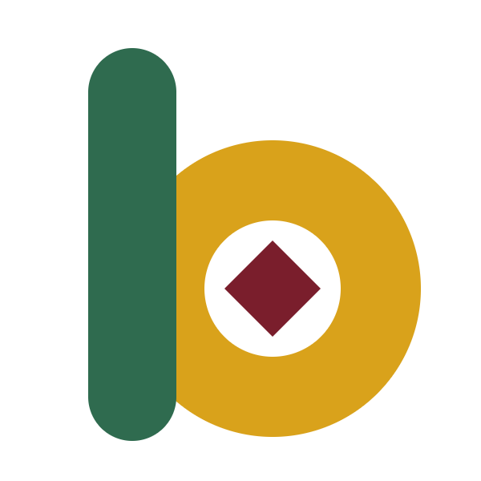

<div align="center">



# Boka · Bone Karya

**Karya Karang Taruna & UMKM Kabupaten Bone, kini satu klik dari rumah Anda.**

Toko daring resmi yang mempertemukan produk lokal Bone dengan pembeli di mana pun.


</div>

---

## Tentang Boka

Kabupaten Bone punya banyak karya yang layak dikenal lebih luas: kopi robusta dari dataran tinggi, sarung sutra *lipa' sabbe*, hasil laut dari pesisir Bajoe, kue tradisional, kerajinan anyaman, sampai madu hutan. Sebagian besar dibuat oleh Karang Taruna desa dan pelaku UMKM yang selama ini hanya menjual dari mulut ke mulut atau di pasar sekitar.

**Boka (Bone Karya)** hadir sebagai etalase digital bersama untuk mereka. Pembeli bisa menjelajah, mencari, dan membeli produk asli Bone dengan cara yang sudah akrab, seperti berbelanja di marketplace. Setiap produk mencantumkan siapa pembuatnya beserta desa dan kecamatannya, sehingga pembeli tahu cerita di balik barang yang mereka beli.

Pada tahap awal, Boka dikelola sebagai toko tunggal oleh tim Admin resmi. Fondasinya dirancang agar kelak bisa tumbuh menjadi marketplace tempat setiap produsen mengelola tokonya sendiri.

## Visi

> Menjadi rumah digital bagi karya Karang Taruna dan UMKM Kabupaten Bone, tempat produk lokal tampil setara, dipercaya pembeli, dan menggerakkan ekonomi desa.

## Misi

1. **Membuka pasar yang lebih luas** bagi produk Karang Taruna dan UMKM Bone, dari dalam kabupaten sampai ke seluruh Indonesia.
2. **Memberi giliran tampil yang adil.** Produk kecil dan jarang dicari tetap mendapat ruang di halaman toko, tidak tenggelam oleh produk yang sudah populer.
3. **Menjaga kepercayaan transaksi** lewat pembayaran yang diverifikasi dengan cermat, rekening resmi yang jelas, dan perlindungan data pribadi pembeli.
4. **Mengangkat cerita di balik produk**, yaitu desa, kelompok pemuda, dan pelaku usaha yang membuatnya.
5. **Mudah dipakai semua kalangan**, baik pembeli maupun pengelola dengan pengalaman teknologi yang beragam.

## Tujuan

| Tujuan | Wujud nyata di Boka |
| --- | --- |
| Promosi produk lokal | Katalog lengkap dengan profil produsen, kabar kegiatan, dan tombol bagikan ke WhatsApp |
| Belanja yang mudah | Pencarian instan, keranjang yang tersimpan, checkout satu halaman |
| Pengiriman yang masuk akal untuk Bone | Pengiriman dari beberapa titik di Kabupaten Bone, kurir lokal, dan ambil sendiri |
| Transaksi aman | Transfer bank dengan kode unik, verifikasi oleh Admin Transaksi, dan peringatan rekening resmi |
| Keputusan berbasis data | Laporan penjualan dan daftar kata kunci yang dicari warga tetapi belum tersedia, sebagai masukan langsung bagi produsen |

## Untuk Siapa Boka Dibuat

- **Pembeli:** warga Bone, perantau, dan siapa saja yang ingin produk asli Bone.
- **Karang Taruna dan UMKM:** produsen yang ingin produknya dikenal dan terjual lebih luas.
- **Pengelola toko:** tim Admin yang mengurus produk, stok, pembayaran, dan pengiriman lewat panel yang sederhana.

## Sorotan

- 🛍️ **Belanja tanpa harus mendaftar dulu.** Pengunjung bisa menjelajah dan mencari; akun baru diminta saat checkout.
- 🔎 **Pencarian instan** dengan saran sejak huruf pertama.
- ✨ **Rekomendasi tanpa AI** yang transparan, termasuk blok "Jelajahi juga" untuk produk yang jarang terlihat.
- 📦 **Satu pesanan, beberapa paket.** Barang dari titik asal berbeda dikirim terpisah dengan ongkir masing-masing.
- 🔐 **Pembayaran yang diverifikasi manusia** berdasarkan mutasi rekening, bukan sekadar foto bukti transfer.
- 🌏 **Dua bahasa** (Indonesia dan Inggris) serta **mode terang dan gelap**.
- 📱 **Siap untuk aplikasi mobile** lewat API yang sudah tersedia.

## Identitas Visual

Tema **"Bugis Modern"**: hangat, bersih, dan lapang. Identitas Bugis-Bone hadir di permukaan, sedangkan pola belanjanya tetap familiar.

| Warna | Kode | Makna |
| --- | --- | --- |
| Merah marun | `#7A1E2C` | Warna kain sutra Bugis, untuk aksi utama |
| Emas kunyit | `#D9A21B` | Promo dan harga spesial |
| Hijau daun | `#2F6B4F` | Keberhasilan dan ketersediaan |
| Krem | `#FAF6EE` | Latar yang hangat |

Logo Boka menggabungkan huruf **b**, lingkaran, dan belah ketupat yang terinspirasi konsep *sulapa eppa* (segi empat) dalam budaya Bugis. Huruf memakai Plus Jakarta Sans, huruf rancangan Indonesia berlisensi terbuka.

## Teknologi

Laravel 13 · Inertia.js 3 · React 19 + TypeScript (dengan SSR) · Tailwind CSS 4 · MySQL

Boka dibangun sebagai satu aplikasi utuh yang melayani toko web, panel Admin, dan API mobile dari aturan bisnis yang sama.

## Status Proyek

Boka sedang berada di **Fase 1 (MVP toko inti)**. Fitur belanja, pembayaran, pengiriman, panel Admin, dua bahasa, dan API mobile sudah berjalan dan teruji otomatis. Saat ini tim sedang menyiapkan peluncuran: optimasi gambar, ekspor laporan lanjutan, dan infrastruktur produksi.

## Rencana ke Depan

| Fase | Fokus | Status |
| --- | --- | --- |
| Fase 0 · Fondasi | Rancangan, identitas visual, infrastruktur | 🚧 Dirampungkan bersama Fase 1 |
| Fase 1 · Toko inti | Katalog, pencarian, keranjang, checkout, pembayaran, panel Admin, API mobile | 🚧 Persiapan peluncuran |
| Fase 2 · Promosi & wawasan | Rekomendasi lengkap, laporan lanjutan, pencocokan mutasi rekening otomatis, verifikasi WhatsApp | 🗓️ Direncanakan |
| Fase 3 · Mobile & asisten Admin | Aplikasi mobile, notifikasi push, asisten AI untuk operasional Admin | 🗓️ Direncanakan |
| Fase 4 · Skala | Payment gateway otomatis, akun penjual untuk setiap produsen (marketplace), "Sering dibeli bersama" | 🔭 Visi jangka panjang |

## Untuk Developer

Ingin mencoba atau ikut mengembangkan Boka? Mulai dari sini:

```bash
composer install && npm install
cp .env.example .env && php artisan key:generate
php artisan migrate --seed
npm run build:ssr && composer dev
```

Pengguna Windows dengan XAMPP cukup klik dua kali `mulai.bat`.

Panduan lengkap mulai dari instalasi, konfigurasi, alur bisnis, API, sampai deploy produksi tersedia di **[docs/Dokumentasi-Instalasi-dan-Implementasi-Boka.md](docs/Dokumentasi-Instalasi-dan-Implementasi-Boka.md)**.

Beberapa prinsip yang kami jaga dalam kontribusi:

- Aturan bisnis ditulis sekali di `app/Domain` dan dipakai bersama oleh web, API, dan panel.
- Setiap aturan bisnis punya tes otomatis. Fitur dianggap selesai saat tesnya lulus.
- Warna hanya lewat token desain, agar mode gelap dan identitas visual tetap konsisten.

## Kontak

Boka · Bone Karya
Watampone, Kabupaten Bone, Sulawesi Selatan

Untuk kerja sama, pertanyaan teknis, atau akses repositori, hubungi tim pengelola Boka.

---

<div align="center">
<sub>Dibuat dengan bangga untuk Karang Taruna dan UMKM Kabupaten Bone.</sub>
</div>
